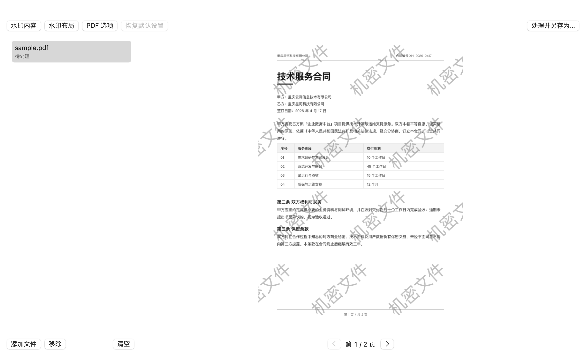
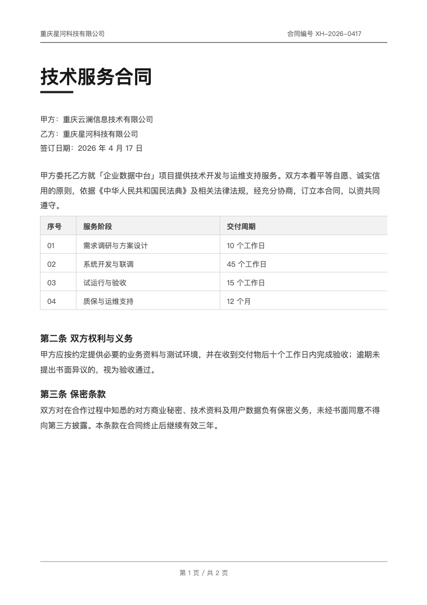
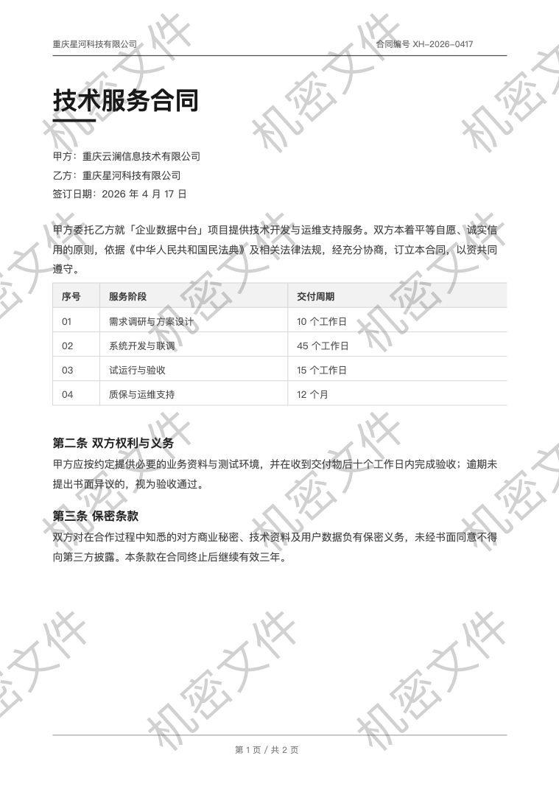

# 水印 · Watermark

**给 PDF 和图片加水印的 macOS 原生小工具。** 纯 Swift 编写，零第三方依赖，完全离线运行。

不覆盖原文件、不重新压缩、不破坏已有签名——PDF 走增量更新，图片保持原格式与原 EXIF。



<p align="center">
  
  
  
  
  
</p>

---

## 为什么不用现成的加水印网站

在线的加水印服务要你把合同、发票、征信报告传上去；桌面端的批量工具往往按页把整份 PDF 重新排版一遍，输出体积翻倍，书签、表单、注释、数字签名全部丢失。这个工具只做一件事，做法尽量克制：

- **原文件一个字节都不改**：PDF 只在末尾追加，原内容流不解压不重压；图片输出到新文件。
- **不联网**：没有任何网络请求代码，断网、拔网线、断 DNS 都一样用。
- **不装东西**：`Watermark.app` 就是全部，没有后台服务、没有 daemon、没有 Electron。

---

## 特性

| | |
|---|---|
| **文字水印** | 任意文本、多行、8 种字体、字号/颜色/加粗/描边/字距/行距全可调 |
| **图片水印** | PNG / JPEG 任选，按画布宽度百分比缩放，可当图章也可铺满 |
| **实时预览** | 调参即时重绘，所见即所得；PDF 可翻页预览 |
| **批量处理** | 多选文件一次加入，统一导出到指定目录，逐个回显处理结果 |
| **加密 PDF** | 「权限型加密」（空密码可打开、仅限制打印编辑）自动解除后再加水印 |
| **9 个锚点** | 四角、四边中点、居中，外加自定义坐标 |
| **平铺** | 可设间距倍数与错行，从画布外一路铺到对侧，不留空边 |
| **页面范围** | 全部 / 仅首页 / 奇数页 / 偶数页 / 指定页（`1,3,5-9`、`2-`、`-4`） |
| **层级** | 水印可放在页面内容之上或之下 |
| **设置记忆** | 关掉再打开还是上次的参数；可一键恢复默认（会先列出将被重置的项） |

---

## 下载

从仓库的 **Releases** 页面下载 `Watermark.dmg`，或直接使用仓库里的 [`website/assets/Watermark.dmg`](website/assets/Watermark.dmg)（约 1.1 MB）。

打开 DMG，把「水印」拖进「应用程序」即可。

> **首次打开被 Gatekeeper 拦下？**
> 应用没有 Apple Developer ID 签名（证书 $99/年），macOS 会提示「无法验证开发者」。这是预期行为，不是文件损坏。任选一种放行：
> - 在「应用程序」里 **右键 → 打开 → 打开**；
> - 或执行 `xattr -dr com.apple.quarantine /Applications/Watermark.app`。
>
> 想彻底没有这个提示，需要有证书后自行签名并公证：`SIGN_IDENTITY="Developer ID Application: ..." ./Scripts/build-app.sh && ./Scripts/notarize.sh`。

---

## 快速上手

1. 打开应用，把 PDF 或图片**拖到窗口任意位置**（也可以点「添加文件」）。
2. 点顶部三个按钮调参数：**水印内容** / **布局** / **PDF 选项**。
3. 右侧实时预览，PDF 可翻页确认每一页。
4. 点「处理并另存为…」。单文件弹出保存框，多文件先选输出目录。

输出文件名自动追加 `_wm` 后缀（`合同.pdf` → `合同_wm.pdf`），重名时变成 `_wm-1`、`_wm-2`。**永远不会覆盖源文件。**

---

## 支持格式

| 类型 | 支持情况 | 说明 |
|---|---|---|
| PDF | 完整支持 | 任意版本、任意页数；扫描件、表单域、注释、书签均保留 |
| JPEG / JPG | 支持 · 有损 | 用原图量化表反推压缩档位，不二次降档 |
| PNG | 支持 · 无损 | 保留透明通道与位深 |
| HEIC / HEIF | 支持 · 接近无损 | 最高质量写回，保留 EXIF、GPS、色彩描述文件 |
| TIFF / BMP / TGA / ICO | 支持 | 系统 ImageIO 能解码且单帧的位图，原格式输出 |
| GIF / 动态 WebP | 不支持 | 加水印会丢动画，直接报错而不是悄悄转静帧 |
| Word / Excel / PPT | 不支持 | 请先导出为 PDF |
| 有打开密码的 PDF | 需先解除 | 不猜密码；仅权限型加密会自动处理 |

---

## 效果

**PDF：前后对比**（虚构的技术服务合同，2 页 A4，42° 斜置平铺）

| 原文件 | 加水印后 |
|---|---|
|  |  |

**图片水印：把图标当图章**（900 × 1180 JPEG，宽占比 16%，不透明度 0.55，右下角）


完整的效果演示、参数表与原理说明在 [`website/index.html`](website/index.html)，直接用浏览器打开即可（零外部依赖，不加载任何 CDN）。

---

## 工作原理

### 1. PDF：增量更新，而不是重写

输出文件 = **原始字节的完整副本** + 末尾追加的新对象 + 一份新的交叉引用表。原页面内容流不解压、不重新压缩，`/Info`、XMP、书签、注释、表单、嵌入字体、图片原样保留，已有数字签名仍然有效。

```
%PDF-1.7
... 原始全部字节，一字未动 ...
<新增：水印内容流 / XObject / 重建的页树>
startxref
<追加的 xref + trailer，/Root 指向新页树>
```

这样做的直接结果是体积增量只有几 KB——实测一份 56 页、带扫描图的销售合同，整份追加约 7.8 KB。

### 2. 水印挂内容流还是注释，看页面有没有注释

PDF 的渲染顺序固定是「页面内容 → 注释」，注释永远盖在内容之上。所以当页面本身带 `/Annots`（印章、图形水印、批注）时，内容流里的水印会被完全遮住。此时把水印自己也做成注释追加到 `/Annots` 末尾，才能排在最上层。

判定依据是水印与页面注释的**覆盖面积比**：注释覆盖超过 30% 才走注释路径，否则走内容流（注释路径会牺牲文字层的可选性，能不用就不用）。

### 3. `/Rotate 90 / 270` 页面：先摆正，再铺水印

扫描件与销售合同常见「MediaBox 是横向 842×595，但带 `/Rotate 270`」——视觉上明明是竖版。直接按 MediaBox 铺水印，水印会被旋转到页面外，只剩右下角一角。

处理方式是照搬 macOS「预览.app → 导出为 PDF」的做法：

1. MediaBox 换成**视觉尺寸**（宽高互换）；
2. 删掉 `/Rotate`；
3. 原内容流整体包一层旋转矩阵（`q <matrix> cm ... Q`）。

图片字节不变（扫描件不会二次压缩），文字层保留，观感与预览.app 的导出结果一致。

### 4. 图片：只重画水印那几层，其余照抄

- 输出 UTI 与输入完全一致（PNG 出 PNG，HEIC 出 HEIC）；
- EXIF / TIFF / GPS / IPTC / ICC 属性字典整体回写；
- 沿用原图色彩空间与位深，不物理旋转像素、不改 EXIF 方向；
- JPEG 从量化表反推原压缩档位，避免二次压缩后画质逐代下降。

> JPEG 重编码在数学上无法做到无损，这是格式决定的，应用会在状态里标出「JPEG 复用原压缩档」而不是谎称无损。

---

## 把 WatermarkCore 当库用

`WatermarkCore` 是不依赖 AppKit 的独立 library target，可以单独引用（PDF、图片、预览渲染都在里面）。

```swift
import WatermarkCore

var config = WatermarkConfig()
config.kind = .text
config.text.content = "机密文件"
config.text.fontSize = 28
config.layout.rotationDegrees = 42
config.layout.opacity = 0.3
config.layout.tiling = true
config.pdf.placement = .above
config.pdf.pageRange = .custom(indices: PDFPageRange.parse("1-5,8"))

let processor = WatermarkProcessor(config: config)
let result = try processor.process(fileAt: URL(fileURLWithPath: "in.pdf"))
try result.data.write(to: URL(fileURLWithPath: "out.pdf"))

print(result.detail)      // 56 页 · 水印 56 页 · 增量 7.8 KB
print(result.isLossless)  // true
```

目前尚未拆成独立仓库，通过本地路径引用：

```swift
.package(path: "../水印/swift")
```

`WatermarkConfig` 全字段 `Codable`，可以直接存 JSON 做配置模板。

---

## 构建

要求 macOS 13+ 与 Xcode 命令行工具（Swift 5.9+）。

```bash
cd swift

# 开发构建
swift build && swift run watermark-app

# 组装 .app（输出到 swift/dist/Watermark.app）
./Scripts/build-app.sh

# 打 DMG
./Scripts/make-dmg.sh

# 重新生成图标（CoreGraphics 矢量绘制 → iconset → icns）
swift Scripts/make-icon.swift
```

签名与公证（需要 Apple Developer Program）：

```bash
SIGN_IDENTITY="Developer ID Application: Your Name (TEAMID)" ./Scripts/build-app.sh
SIGN_IDENTITY="Developer ID Application: Your Name (TEAMID)" ./Scripts/make-dmg.sh
APPLE_ID="you@example.com" TEAM_ID="XXXXXXXXXX" APP_PASSWORD="xxxx-xxxx-xxxx-xxxx" \
  ./Scripts/notarize.sh
```

## 测试

```bash
cd swift && swift test
```

60 条单元与回归测试，覆盖：PDF 增量更新的字节保留、对象流与 xref 解析、`/Rotate` 页面摆正、加密 PDF 解除、注释路径分流、图片保真与 EXIF 回写、平铺与缩放的跨画布一致性、渲染墨迹量等。

部分用例需要真实样本文件，缺失时自动跳过而非失败。

---

## 目录结构

```
.
├── swift/                        # Swift Package
│   ├── Sources/
│   │   ├── WatermarkCore/        # 核心库（无 AppKit 依赖）
│   │   │   ├── Model/            # 配置模型、布局计算
│   │   │   ├── PDF/              # 原始 PDF 解析 / 增量写入 / 页面几何
│   │   │   ├── Image/            # 图片管线、EXIF、JPEG 质量反推
│   │   │   ├── Preview/          # 预览渲染
│   │   │   └── Codec.swift       # zlib 编解码（手写 RFC 1950 头与 Adler32）
│   │   └── WatermarkApp/         # SwiftUI 应用
│   ├── Tests/WatermarkCoreTests/
│   ├── Scripts/                  # 构建、打包、公证、图标生成
│   ├── Resources/                # Info.plist、AppIcon.icns
│   └── dist/                     # 构建产物
└── website/                      # 单页产品网站
    ├── index.html
    └── assets/
```

---

## 已知限制

- **不支持需要密码才能打开的 PDF**。应用不猜密码，也不做暴力破解。仅「空密码可打开、只限制打印编辑」的权限型加密会自动解除（这条路是整份重写，扫描件的图片可能被重新编码，因此会标记为非无损）。
- **不支持动图**（GIF、动态 WebP），加水印必然丢帧。
- **不处理 Office 文档**，请先导出 PDF。
- **JPEG 无法无损**，见上文说明。
- **未签名**，首次打开需要手动放行。

---

## 许可

[MIT](LICENSE) © 2026 adong

可自由使用、修改、分发与商用，保留版权声明与许可声明即可。软件按「原样」提供，不附带任何担保。
